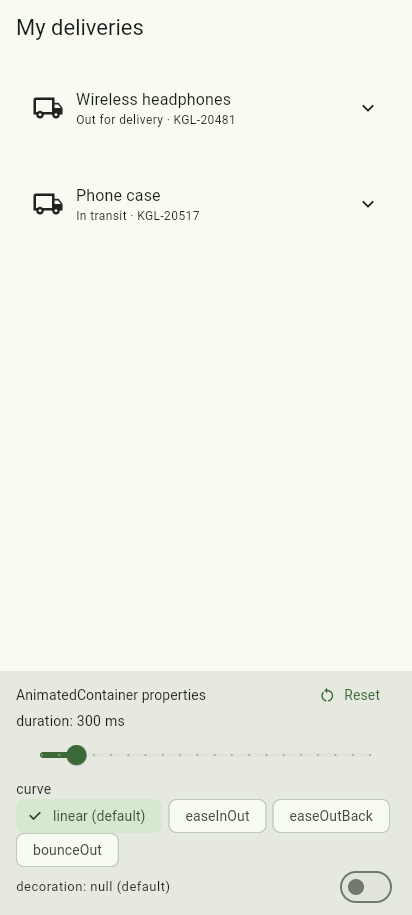

# Parcel Tracker – AnimatedContainer

<!-- TODO (write in your own words): one sentence describing what AnimatedContainer does. -->

**Presenter:** Mugisha Moses

## Run it

```bash
flutter pub get
flutter run
```

Run the tests with `flutter test`.

## The three attributes

<!-- TODO (write in your own words): for each one, give the default value, what changes on screen, and why a developer would change it. -->

### 1. `duration`

### 2. `curve`

### 3. `decoration`

## Screenshot



## Sources

<!-- TODO: list any tutorials or docs you used, e.g. https://api.flutter.dev/flutter/widgets/AnimatedContainer-class.html -->
