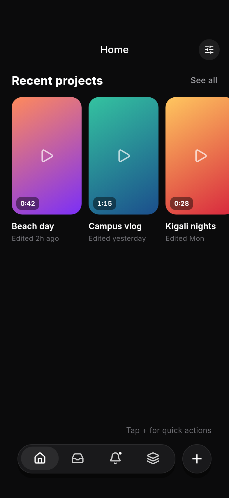
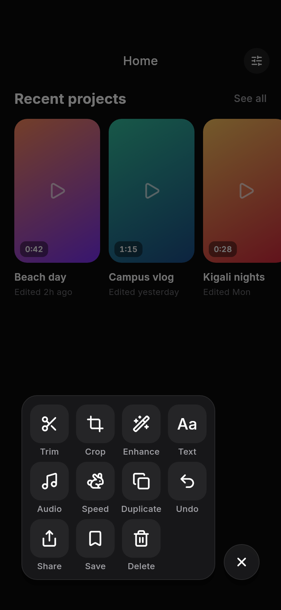
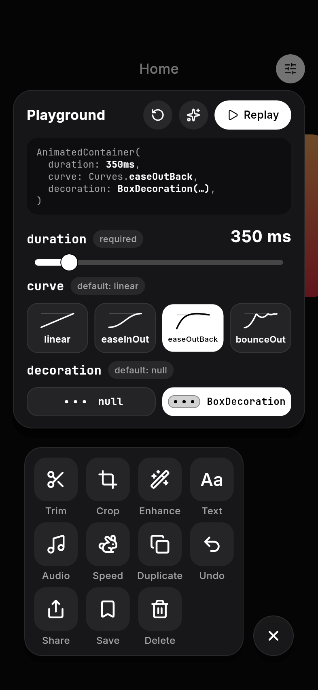

# Clipo – AnimatedContainer

<!-- TODO (write in your own words): one sentence describing what AnimatedContainer does. -->

**Presenter:** Mugisha Moses

Clipo is the home screen of a video editor. Tapping **+** turns the bottom navigation bar into a quick-actions panel, and the whole shape change is one `AnimatedContainer` (`lib/widgets/morphing_bar.dart`). The tune button at the top right opens a playground for changing the three properties live.

## Run it

```bash
flutter pub get
flutter run
```

Run the tests with `flutter test`.
Regenerate the screenshots with `flutter test tool/screenshots_test.dart`.

## The three attributes

<!-- TODO (write in your own words): for each one, give the default value, what changes on screen, and why a developer would change it. -->

### 1. `duration`

### 2. `curve`

### 3. `decoration`

## Screenshots

| Closed bar | Quick-actions panel | Playground |
|---|---|---|
|  |  |  |

## Sources

<!-- TODO: list any tutorials or docs you used, e.g. https://api.flutter.dev/flutter/widgets/AnimatedContainer-class.html -->

- Icons: [Lucide](https://lucide.dev) via `lucide_icons_flutter`
- Fonts: [Inter](https://rsms.me/inter/) and [JetBrains Mono](https://www.jetbrains.com/lp/mono/) (SIL Open Font License, see `assets/fonts/`)
- Bottom-bar design inspiration: <!-- TODO: link to where the reference video/design came from -->
